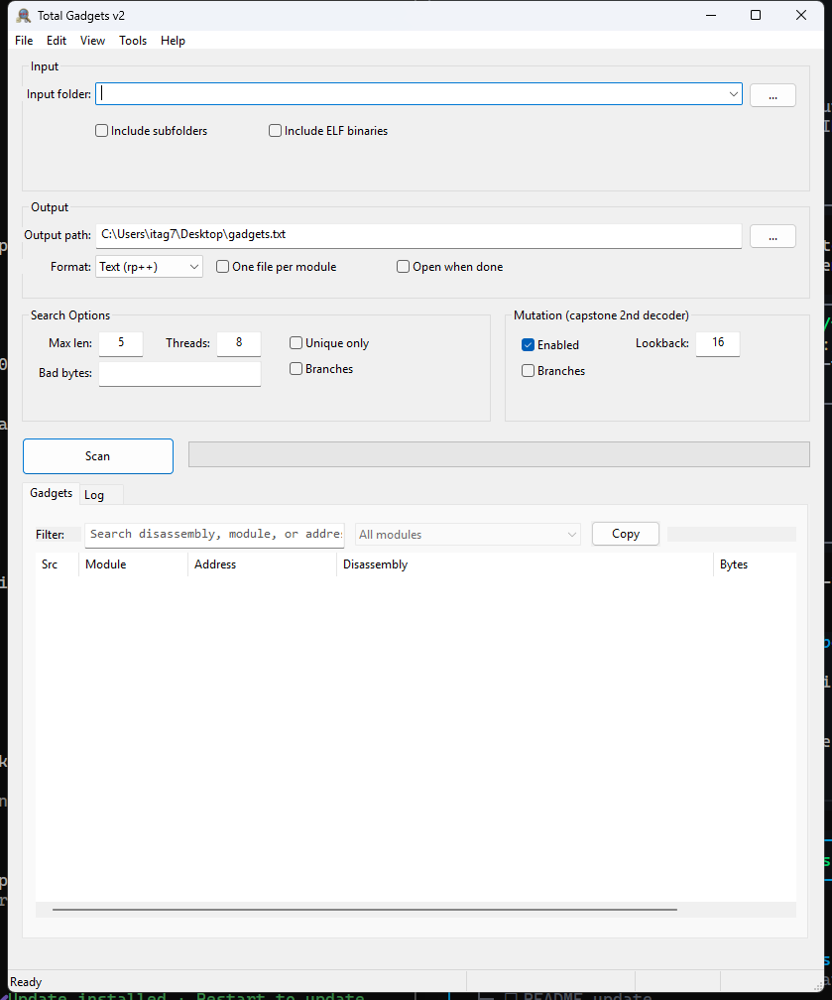

# Total Gadgets

Bulk ROP gadget extraction for Windows binaries. GUI and CLI in one exe.

Point it at a folder of PE files (ELF opt-in), extract gadgets with
[librp](https://github.com/0xntpower/librp) (the rp++ engine as a static
library), browse and filter the results in the app, and write them out as
rp++-style text, JSON, or CSV.



The mutation pass is a second scan with capstone, anchored at every terminal
instruction (ret, ret imm, indirect call/jmp, syscall, int 0x80, int 0x2e).
Whatever the main BeaEngine pass missed gets reported as a mutated gadget:
decoder disagreements, gadgets that start past a branch, deeper lookback. On a
System32 DLL sweep it typically adds 10-20% unique gadgets.

## Download

Grab the exe from [releases](https://github.com/0xntpower/TotalGadgets/releases).
The MSVC runtime is linked statically, so it runs standalone, no installer.

## CLI

```
TotalGadgets --cli [options] <folder-or-file> [folder-or-file ...]

  -o, --output <path>   Output file (or directory with --split)
  -f, --format <fmt>    text | json | csv           (default: text)
      --split           One output file per module
  -r, --recursive       Scan subfolders
  -l, --max-len <n>     Max instructions per gadget (default 5)
  -t, --threads <n>     Parallelism (default: half the CPU cores)
  -u, --unique          Unique gadgets only
  -b, --bad-bytes <hex> Bad bytes for gadget addresses, e.g. "00 0a"
      --allow-branches  Allow branch instructions inside gadgets
      --elf             Also accept ELF binaries
  -m, --mutate [=<n>]   Capstone second-decoder pass, n = lookback bytes (default 16)
      --mutate-branches Allow branches inside mutated gadgets
  -q, --quiet           No per-file log output
      --selftest        Run the built-in regression suite
```

Exit codes: 0 ok, 1 scan or write errors, 2 usage, 130 cancelled.

```
TotalGadgets --cli -r -f json -m -o out.json C:\dropped\sample
TotalGadgets --cli -u -b "00 0a" -o chain.txt ntdll.dll
TotalGadgets --selftest
```

Run without arguments to get the GUI.

## Performance

Measured A/B on this machine, 8 threads:

| Workload | v2.0 | v2.1 |
|---|---|---|
| 120-DLL System32 sweep, scan + mutation | 20.7-25.5 s | 16.1-17.6 s |
| 3 large DLLs, mutation only | 6.2-7.1 s | 5.3-5.8 s |
| `--selftest` | 5.0 s | 0.5 s |

The v2.1 pass removed most per-file overhead: one file open per binary instead
of five, header-only PE reads during the scan, capstone `cs_disasm_iter` with
per-thread instruction buffers, and one buffered block write per module instead
of a stream op per gadget. Mutation output is deterministic across runs and
thread counts.

## Bad bytes

Same meaning as in rp++: a bad byte may not appear in a gadget's address (the
low 4 bytes are checked), not in its instruction bytes. That is the "no null
bytes in the chain" constraint.

## GUI

The results list is virtual-mode, so a million gadgets scroll and filter fine;
filtering is debounced at 150 ms. A scan can be cancelled at any point, and
modules are written to disk as they finish, so a cancelled run still leaves a
valid partial output file. Settings, window placement and the folder MRU
persist in `%LOCALAPPDATA%\TotalGadgets\settings.ini`.

## Building

Needs MSVC (VS 2022 or newer), Python, the vcbuild submodule, a built
[librp](https://github.com/0xntpower/librp) at `../librp/build-x64/Release/`,
and WTL 10 headers at `../vcbuild/gui/external/Include/`.

```
git submodule update --init
python vcbuild/vcbuild.py
```

## Limits

- The mutation pass maps addresses through PE sections, so it skips ELF
  modules and logs them.
- The GUI keeps results in memory for the browser; very large sweeps use RAM
  proportional to the output size. The CLI always streams to disk.

MIT, see [LICENSE](LICENSE).
